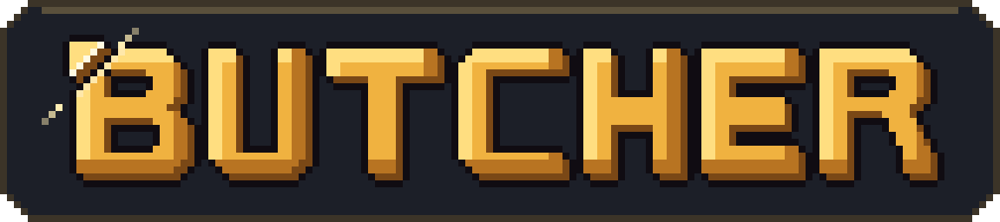

  

<h1 align="center">Butcher</h1>

  <b>Your rare drops deserve a cutscene. Your busts deserve one too, it's only fair.</b> 
  A client-side Fabric mod for Hypixel SkyBlock &middot; Minecraft 26.2

---

You've killed the boss. Something dropped. Hypixel would like to tell you what, immediately, in chat,
with a little *ding*.

**Butcher would rather you suffer a bit first.**

The moment a rare-drop source dies, Butcher hides the evidence (chat, HUD, the loot sound, the item on the floor)
and plays a short, fully animated cutscene over your game. Somewhere at the end of it is the answer. Maybe it's a
1-in-2,000 pet. Maybe it's gemstones. It's gemstones.

It is, in short, a slot machine for loot you have already won (or haven't). Every animation is drawn and scored
by the mod itself: real 3D models, pixel-art effects and a soundtrack synthesised live, with no texture packs or
sound files to download.

## The cutscenes

| Where | Cutscene | Plays when |
| --- | --- | --- |
| Crystal Hollows | **The Cleaver** | You kill a Scatha. Pet or pebbles, the worm gets the full treatment. |
| Glacite Mineshafts | **The Thaw** | You open a Vanguard corpse. Ice is struck, the frost spreads, the loot is revealed, then a profit window tells you if it was worth the key. Two jackpots in one corpse get a twist of their own. |
| Crystal Nucleus | **The Vault** or **The Gauntlet** | You place the fifth crystal. Pick your style: a vault door that opens on your haul, or a golden gauntlet that takes the crystals. Divan's Alloy, the Jade Dye and (in the Vault) the Quick Claw get their own endings. |
| Diana's Mythological Ritual | **The Chopping Block** | A Sphinx, Minos Inquisitor, Manticore or King Minos dies, or a Minos Relic or Mythological Dye drops. Every big drop has its own ending. |
| Inferno Demonlord IV | **Hellion** | Your own Demonlord dies. The shield cycles, the rods spin up, the dice get thrown. |
| Revenant Horror V | **The Grave** | Your own Revenant dies (a tier IV only for its dye). The shovel digs, the coffin opens. |
| Tarantula Broodfather V | **The Cocoon** | Your own Tarantula dies (a tier IV only for its dye). Something is wrapped up in silk. |
| Crimson Isle lava fishing | **Eruption** | You kill Lord Jawbus, a Thunder, a Ragnarok or a Fiery Scuttler (Plhlegblast only gets one for the Carmine Dye). |
| Fishing Festival | **Fin** | A quick pop-up when a Great White Shark gives you a Megalodon or a Shark Tooth, and an even quicker one when it doesn't. |
| Dwarven Mines | **Wisp** | A quick pop-up when a Ghost drops Sorrow or Plasma. |
| Crystal Hollows | **The Automaton** | A quick pop-up when an Automaton drops one of its robot parts. |
| The End | **Summoning Eye** | A quick pop-up when a Special Zealot drops a Summoning Eye. |
| The Garden | **Crop Fever and visitors** | A glow while Crop Fever lasts, a pop-up for each of its drops, and one for a visitor's big reward. |
| Voidgloom Seraph IV | **The Seraph's Glyph** | 🚧 *Under maintenance.* It's being polished and is switched off in this release. |

### The rules of the house

- **It never lies.** Nothing before the reveal depends on what dropped. A long build-up is not a promise, a
  short one is not a warning, and the colour that flickers last is the true one. The tension is real because the
  tell is honest.
- **You keep control.** Cutscenes play over the game, not in a menu. Walk, look around, keep fighting.
- **Nothing gets lost.** Chat that arrives during a cutscene is held and put back afterwards, in order.
- **Busts are quick.** Nobody needs a 20-second funeral for a stack of Flawed Gemstones. Busts can be shortened or
  skipped entirely, per source.
- **Big drops get a show.** Their own ending, a banner, the odds, the price counting up (live from the Bazaar and
  Auction House), and a note of how many you've had.

## Installing

1. Install [Fabric Loader](https://fabricmc.net/use/installer/) 0.19.0+ for **Minecraft 26.2**.
2. Drop [Fabric API](https://modrinth.com/mod/fabric-api) into your `mods` folder.
3. Drop the Butcher jar in next to it.
4. *(Optional)* [Mod Menu](https://modrinth.com/mod/modmenu), to open the settings from the mods list.

Java 25 is required, and the Minecraft 26.2 launcher already ships it.

## Using it

Type **`/butcher`** (or use Mod Menu's *Configure* button) to open the settings.

- **Animations**: every cutscene has its own card. Switch it on or off, pick which creatures trigger it, how early
  the HUD hides, how busts play, the speed, the size and the volume. Each card ends with **Try it**, which plays any outcome
  on demand. It never counts towards your stats, so go ahead and "win" a Mythological Dye. We won't tell.
- **General**: live prices, the minimum drop value worth a cutscene, the chat summary, calmer effects for anyone
  who'd rather their screen didn't shake or flash, and an automatic screenshot of every big drop's showcase.
- **Sound**: every volume, and whether the game is muted, quieter or untouched while a cutscene plays.
- **Stats**: your dry streaks and drops, per source. Only real kills count, so the number of Scathas since your
  last pet is, unfortunately, accurate.
- **Ledger**: The Butcher's Ledger, a leather-bound book of 178 ink stamps with a chapter per animation. Kill
  counts, every rare drop, and the luck you'd rather not talk about: a pet in your first ten kills of the day, two in
  a row, a drop at 3 AM, a dry streak worth framing. Tiered stamps are graded like beef: Select, Choice, Prime and A5
  Wagyu. They take real effort, and some are secret until you earn them. Everything your stats already prove is
  stamped the first time you open it.

**Hold Backspace** to skip a cutscene (rebindable under *Controls → Butcher*). A win skips straight to the
showcase, so you still get to see it.

| Command | What it does |
| --- | --- |
| `/butcher` | Opens the settings |
| `/butcher help` | Lists every command |
| `/butcher feedback` | Report a bug or suggest something: the same as `/butcher report` |
| `/butcher reload` | Re-reads the config and redraws the generated art |
| `/butcher stop` | Ends whatever is playing right now and gives you your screen back |
| `/butcher undo` | Lists your last few drops; `/butcher undo <n>` takes one out of your stats (a drop that wasn't yours) |
| `/butcher report` | Saves a bug report (recent decisions, your settings, your version and mods), copies it, and links the bug form on GitHub |
| `/butcher log` | The last 40 detection decisions: every kill accepted or refused, and why |
| `/butcher ledger recheck` | Stamps anything your stats prove that the Ledger is missing |
| `/butcher skins` | Whether the Scatha's skin has been captured yet (`forget` to recapture it) |
| `/butcher records` | How many drop records are saved (only if *Drop records* is on) |

## FAQ

**Is this allowed on Hypixel?**
Butcher only *hides* and *draws* things on your own screen. It never sends packets, clicks, moves or plays for you,
and it doesn't give you any information you wouldn't get anyway (it gives you *less*, for a few seconds). As with
any mod, using it is at your own risk.

**A cutscene played when it shouldn't have (or didn't when it should).**
Click *Report a bug or suggest something* under General (or type `/butcher report`) right after. It saves everything
needed to fix it (what it decided and why, your settings, your mods), copies it to your clipboard and opens the bug
form on [GitHub](https://github.com/caciulaa/butcher/issues): paste it in and say what happened. `/butcher log` shows
the same decisions in chat.

**Can I make the busts shorter?**
Yes. Every source has a *Busts* setting: the whole cutscene, a short one, or none at all (wins only). There's also a
global minimum value, so a drop worth less than you care about plays as a bust.

**Does it phone home?**
No. It talks to `api.hypixel.net` (Bazaar prices) and `sky.coflnet.com` (lowest BIN), sending only item IDs, and
only when *Live prices* is on. It also fetches a few SkyBlock head skins from `textures.minecraft.net`. That's the
whole list.

**Will it make my drops better?**
No. Nothing will. We're sorry.

## Files

Everything lives under `.minecraft/config/`:

- `butcher.json`: your settings. If it ever becomes unreadable it's moved aside to `butcher.json.broken` and the
  defaults are used, so a bad edit never stops the game from starting.
- `butcher/`: stats (with a daily backup of the last three days beside them), the captured Scatha skin, a skin cache,
  and the generated textures.
- `butcher-drops.jsonl`: only if you turn on *Drop records* (off by default). A local log of real kills and drops
  with the chat around them, handy for bug reports. It never leaves your computer.

### Reskinning

Most textures are painted by the mod itself. Turn on *Let me edit the art* (General) and play a cutscene, and its
textures are written to `config/butcher/textures/` for you to edit; `/butcher reload` shows your changes. Edited files
are never overwritten. Delete a PNG to get the original back. The Scatha's own skin
belongs to Hypixel, so it's taken from the first live worm you meet. Put `head.png` / `body.png` in
`config/butcher/skins/` to supply your own.

## Building from source

Run `./gradlew build` (`.\gradlew.bat build` on Windows) and the jar ends up in `build/libs/`.
[CONTRIBUTING.md](CONTRIBUTING.md) has the full steps. Builds are for your own game only.

## Credits

- The HUD fade, the gameplay window and the HUD-hiding approach are adapted from **SkyMaxx** (MIT; its notice is in
  the jar's `LICENSE`).
- Scatha detection follows **Scatha-Pro**'s approach.
- Item and creature head skins and item IDs come from the **NEU item repository**. The Vanguard loot weights are
  cross-checked against **SkyOcean** and the SkyBlock wiki.
- Prices from Hypixel's public API and **Coflnet**.

---

## License

Butcher is **all rights reserved**. You're welcome to download it, play with it, make videos of it and include it in
modpacks that download it from Modrinth, and build it from this source for your own game. Please don't re-upload it,
share your build, modify it or reuse its code or art without asking.

**Ricky** ([therickshow](https://github.com/therickshow)) came up with and created the Revenant and Tarantula cutscenes
(The Grave and The Cocoon), The Garden, the Summoning Eye and the Automatons.

---

Butcher is not affiliated with or endorsed by Hypixel or Mojang. No Scathas were harmed in the making of this
mod. Several thousand were, in the testing of it.
